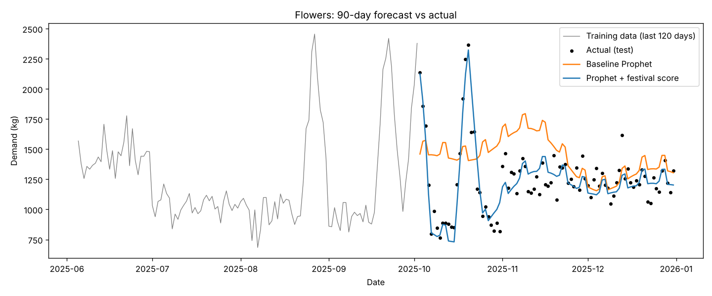
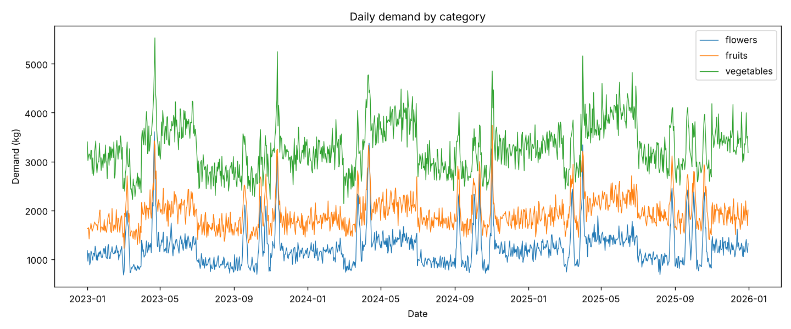
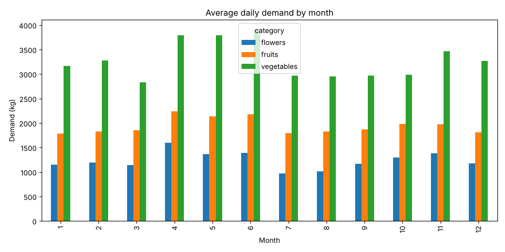
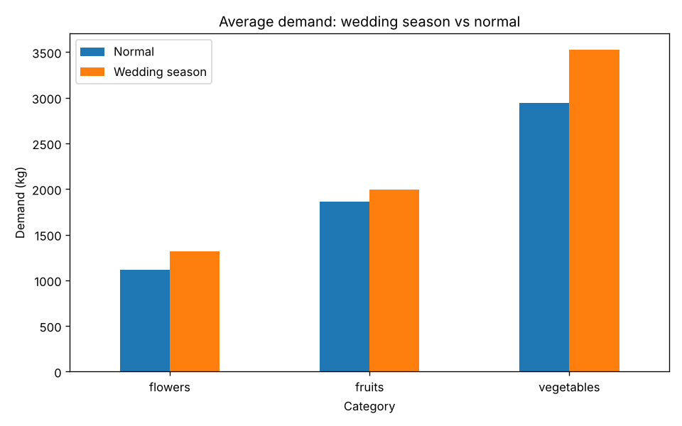
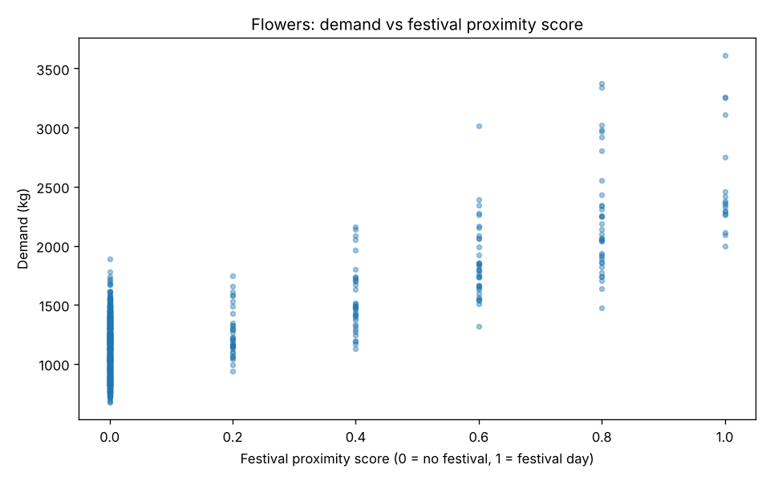

# Seasonal Demand Forecasting System

Forecasting daily demand for **flowers, catering vegetables and fruits** in India, where demand spikes sharply around **wedding seasons** and **major festivals** such as Diwali, Navratri, Durga Puja, Ganesh Chaturthi, Holi and Eid.

Built with **Python** and **Facebook Prophet** as a 4-member Project Based Learning (PBL) project for the MCA (AI & Data Science) programme at Graphic Era Hill University.



## The problem

Vendors and caterers lose money in two ways: ordering too little before a festival (lost sales) or too much after it (wasted, perishable stock). Standard forecasting models learn yearly patterns, but Indian festivals **move to a different date every year** (Diwali was on 12 Nov in 2023, 1 Nov in 2024 and 20 Oct in 2025). A model that only knows the calendar month misses these spikes.

## The approach

1. **Dataset:** 3 years (2023 to 2025) of daily demand for 3 categories, with wedding-season and festival effects.
2. **Feature engineering:**
   - `is_wedding_season`: 1 during Nov to Feb and Apr to Jun, else 0
   - `festival_proximity_score`: 1.0 on a festival day, decaying linearly to 0.2 at four days away, and 0 outside a ±4-day window
3. **Exploratory analysis:** 4 charts covering trends, monthly patterns, wedding-season impact and festival impact.
4. **Models:**
   - **Baseline Prophet:** uses only the date and the demand
   - **Improved Prophet:** adds `festival_proximity_score` as an external regressor (`add_regressor`)
5. **Evaluation:** both models are tested on the **last 90 days**, held out from training, using MAE (kg) and MAPE (%).

## Results

| Category | Model | MAE (kg) | MAPE |
|---|---|---|---|
| Flowers | Baseline Prophet | 298.26 | 26.66% |
| Flowers | **Prophet + festival score** | **92.86** | **7.69%** |
| Fruits | Baseline Prophet | 259.93 | 14.20% |
| Fruits | **Prophet + festival score** | **116.89** | **6.25%** |
| Vegetables | Baseline Prophet | 295.42 | 9.19% |
| Vegetables | **Prophet + festival score** | **175.65** | **5.24%** |

Adding the festival proximity score reduced error in every category. The biggest gain is for **flowers**, the most festival-driven product, where MAPE dropped from 26.66% to 7.69%. The test window includes Diwali 2025 (20 October). The baseline misses that spike, because in earlier years Diwali fell in November. The improved model captures it.

### Charts

| | |
|---|---|
|  |  |
|  |  |

Forecast charts for all three categories are in [`outputs/figures/`](outputs/figures/).

## Project structure

```
seasonal-demand-forecasting/
├── main.py                 # runs the full pipeline
├── requirements.txt
├── src/
│   ├── features.py         # festival dates, wedding season, proximity score
│   ├── generate_data.py    # builds the dataset
│   ├── eda.py              # 4 exploratory charts
│   └── forecast.py         # baseline vs improved Prophet, evaluation
├── data/
│   └── demand_data.csv
└── outputs/
    ├── metrics.csv
    └── figures/
```

## How to run

```bash
git clone https://github.com/priyanshujimiwal/seasonal-demand-forecasting.git
cd seasonal-demand-forecasting
pip install -r requirements.txt
python main.py
```

The full pipeline runs in a few seconds and recreates the dataset, charts and metrics. It also runs on Google Colab: upload the folder, then run `!pip install prophet` and `!python main.py`.

## Note on the data

The dataset is **synthetic**: it is generated by `src/generate_data.py` with realistic wedding-season and festival effects, so the full pipeline could be built and tested end to end. Festival dates are approximate. Using real market data is the next step (see below).

## Future work

- Replace synthetic data with real mandi price and arrival data from **Agmarknet**
- Compare Prophet with **XGBoost** using the same engineered features
- Add separate effects for each festival, since Diwali and Holi affect different products differently
- Build an interactive dashboard with wastage-risk alerts for vendors

## Team

4-member team. **My role: Model Development.** I built the Prophet models, engineered the festival proximity feature, and ran the evaluation.

<!-- Add your teammates' names and GitHub profiles here -->
